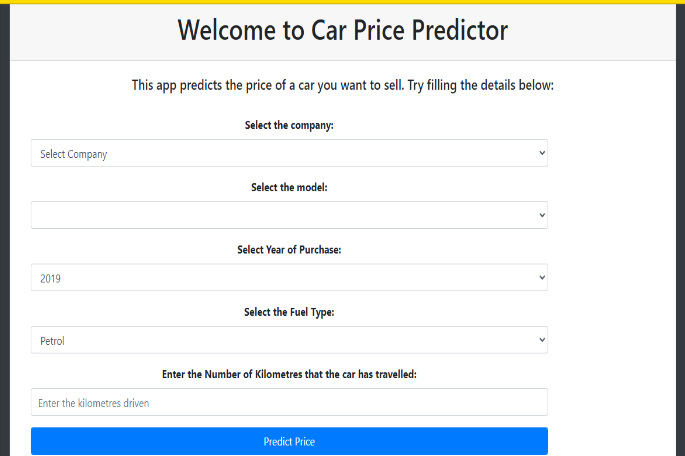
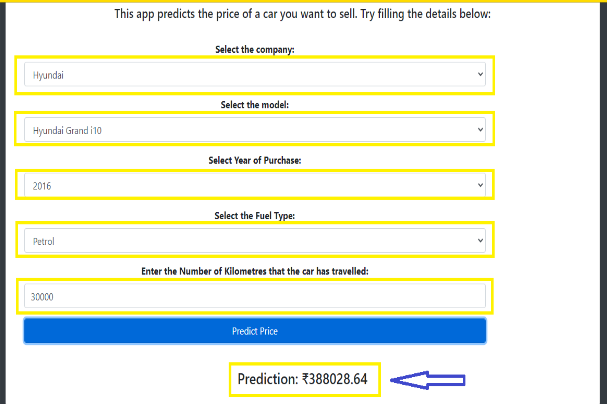

# Car Price Predictor

**Developed by: Harsh Patel**

## Aim

This project aims to predict the resale price of a used car based on its company name, model name, year of purchase, fuel type, and kilometers driven.

## Project Demo





## How to Use?

1. Clone the repository:

   ```bash
   git clone https://github.com/Harsh855-boop/Car-Price-Predictor.git
   ```

2. Navigate to the project directory:

   ```bash
   cd Car-Price-Predictor
   ```

3. Install the required packages from `requirements.txt`:

   ```bash
   pip install -r requirements.txt
   ```

   The main packages used include:
   - NumPy
   - Pandas
   - Scikit-learn
   - Flask

4. Run the application:

   ```bash
   python application.py
   ```

5. Open `http://127.0.0.1:5000` in your browser.

## Description

### What Does This Project Do?

1. The application takes the following car details as input:
   - Company name
   - Car model
   - Year of purchase
   - Fuel type
   - Number of kilometers driven

2. It uses a trained Machine Learning model to estimate the resale price of the car.

3. The predicted price is displayed on the web interface.

For example, the application can estimate the resale price of a Hyundai Grand i10 based on the details entered by the user.

### How Does This Project Work?

1. The project uses car data originally collected from Quikr.com.
2. The raw dataset is cleaned and analyzed to prepare it for Machine Learning.
3. A Linear Regression model is trained using the prepared data.
4. The trained model is saved in `LinearRegressionModel.pkl`.
5. Flask loads the saved model and receives the car details from the user.
6. The model predicts the estimated resale price and displays the result.

## Technologies Used

- Python
- Flask
- Pandas
- NumPy
- Scikit-learn
- HTML and CSS
- Linear Regression

## Project Files

- `application.py` — Flask web application
- `LinearRegressionModel.pkl` — saved Machine Learning model
- `Cleaned_Car_data.csv` — cleaned dataset
- `quikr_car.csv` — raw car dataset
- `Quikr Analysis.ipynb` — data analysis and model development notebook
- `templates/` — HTML templates
- `static/` — CSS and static files
- `requirements.txt` — project dependencies

## Author

**Harsh Patel**

GitHub: [Harsh855-boop](https://github.com/Harsh855-boop)

Repository: [Car Price Predictor](https://github.com/Harsh855-boop/Car-Price-Predictor)
